# GWL Production Meter Intelligence

A React/TypeScript web application and independent Node/Express/PostgreSQL ingestion API for Ghana Water Limited. Gmail is an ingestion channel; the registry, source archive, installation history, readings, and audit trail live in PostgreSQL.

**Current state:** implemented discovery/registry application with automated fixture-based verification. No real Gmail messages or credentials have been supplied. Vendor mappings are deliberately empty. The web interface starts in setup mode. Connecting the real mailbox, verifying representative messages, and production infrastructure acceptance remain required before operational use.

## Structure

- `app/`, `components/`: responsive Sites/Vite React interface and same-origin API proxy.
- `backend/src/`: OAuth, authentication/RBAC, parser adapters, discovery/ingestion, registry and monitoring REST API.
- `database/migrations/`: ordered PostgreSQL migrations and database integrity constraints.
- `backend/test/`: unit, embedded PostgreSQL, and real HTTP API integration tests using synthetic fixtures.
- `docker/`, `compose.yaml`: PostgreSQL and containerized backend.
- `docs/`: API, OAuth, security, operations, and delivery/limitations documentation.

The Sites frontend uses Vinext's React routing on Vite to support the hosting runtime. The PostgreSQL API stays independent and Docker-compatible; it does not use a Cloudflare SQLite substitute.

## Local installation

Requires Node 24, npm, and PostgreSQL 17 (or Docker Desktop with its engine running). On Windows PowerShell, use `npm.cmd` if the execution policy blocks `npm.ps1`.

```powershell
npm.cmd ci
npm.cmd ci --prefix backend
Copy-Item .env.example .env
Copy-Item backend/.env.example backend/.env
```

Edit both ignored `.env` files locally. Set a random `POSTGRES_PASSWORD`, matching `DATABASE_URL`, `TOKEN_ENCRYPTION_KEY` (64 hex characters), and your administrator seed email/password (minimum 14 characters). Never paste credentials into source files. The root web runtime only needs `API_ORIGIN`; API secrets belong in `backend/.env` or an approved secrets manager.

```powershell
docker compose up -d db
npm.cmd run db:migrate
npm.cmd run db:seed
npm.cmd run api:dev
```

In a second terminal:

```powershell
npm.cmd run dev
```

Open the local URL printed by the web server (normally `http://localhost:3000`). Use the seeded administrator to sign in. Keep `APP_ORIGIN` and the OAuth redirect URI aligned with the actual frontend URL. Seeding is idempotent and never changes an existing administrator password. It inserts roles and the initial account, **not fake meter data**. Remove seed-password variables after seeding.

## First-run discovery

1. Follow [Google OAuth setup](docs/GMAIL-OAUTH.md) and connect the dedicated mailbox.
2. Examine representative vendor messages through an authorized channel. Record exact identifier names/types, timestamp/timezone conventions, units, attachment formats, and authenticated sender details.
3. In Configuration, create a parser and explicit field mappings. There are no assumed MAG8000 vendor mappings.
4. Add and enable a trusted source linked to that parser. Sender/domain matching is exact; other configured conditions are conjunctive. Gmail DMARC pass is required by default. Ambiguous source rules fail into review.
5. Set the discovery window, leave automatic ingestion disabled initially, and run **Sync now**.
6. Review discovered identities. Create region, facility, and installation points; match an existing meter or validate/register a new physical asset.
7. Retry relevant source messages to backfill readings. Confirm identifiers, timestamps, units, quality events, and installation periods against the source.
8. Enable scheduled ingestion after acceptance. Check delayed/offline thresholds on each meter.

## Commands

| Purpose | Command |
|---|---|
| Install web/API | `npm ci` / `npm ci --prefix backend` |
| Database migrations | `npm run db:migrate` |
| Initial administrator/roles | `npm run db:seed` |
| Web development | `npm run dev` |
| API development | `npm run api:dev` |
| Type check | `npm run typecheck` |
| API build | `npm run build --prefix backend` |
| Automated tests | `npm test` |
| Web build | `npm run build` |
| API production start | `npm start --prefix backend` |
| Local built web runtime | `npm start` |

`npm start` at the root runs the built Worker with Wrangler locally; it is not a public production HTTP server. Publish the web Worker with Sites, and host the independent API behind HTTPS. Set the site's server-side `API_ORIGIN` to that API's trusted HTTPS origin. See [operations](docs/OPERATIONS.md).

## Validation and production boundary

The integration suite runs PostgreSQL through PGlite and exercises real Express HTTP requests. This validates schema/query behavior without a running Docker engine. It does not replace a real PostgreSQL deployment/load/concurrency test or Google's OAuth consent. See [delivery status](docs/DELIVERY.md) for implemented functionality and remaining acceptance work.

```mermaid
flowchart LR
  Gmail[Gmail API / read-only OAuth] --> Archive[Source messages + attachments]
  Archive --> Rules[Trusted sources + mapped adapters]
  Rules --> Identity[Namespace + identifier kind + normalized value]
  Identity --> Review[Unidentified / conflict review]
  Review --> Registry[Validated physical meter registry]
  Registry --> Install[Historical installation periods]
  Identity --> Readings[UTC readings + quality events]
  Install --> Readings
  Readings --> UI[Monitoring / map / reports / REST API]
```



No financial NRW assumptions or water-balance calculations are enabled. Installation points have upstream references for future validated water-balance topology.
